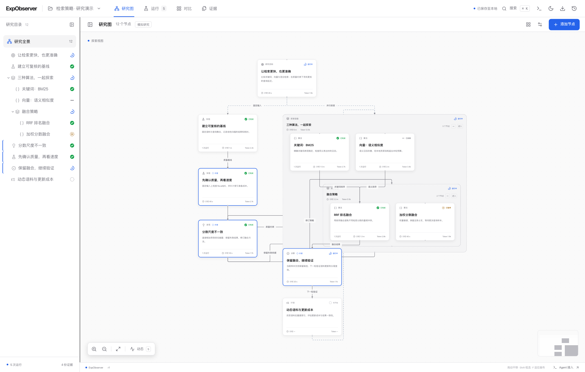
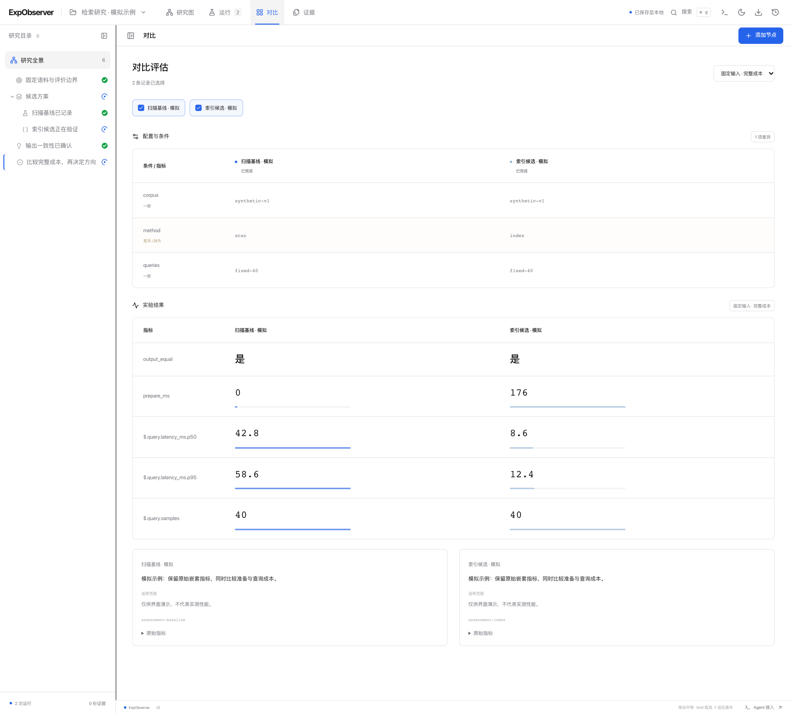

# ExpObserver

[简体中文](README.zh-CN.md)

**A local workspace for observing experiments and research.**

Explore alternatives, keep evidence, and follow how an experiment changes direction. Agents record findings and existing results through a portable Skill; the interface updates from those records. Expand nested alternatives, compare results, and trace the evidence behind a decision across conversations.



*Current interface with synthetic demonstration data: nested candidates, evidence links, and a two-way review loop. Active indicators rotate and connections show directional flow in the app.*

## Quick start

**With an agent:** copy and send this instruction:

> Install and start ExpObserver and its Skill by following https://github.com/EuanTop/exp-observer/blob/main/INSTALL.md.

**By hand:** [download the ready-to-run ZIP](https://github.com/EuanTop/exp-observer/releases/latest/download/exp-observer.zip), extract it, then run this in the extracted `exp-observer` folder:

```sh
python3 start.py
```

On Windows, double-click `start.bat` or run `py -3 start.py`. On macOS, you can also double-click `start.command`. The launcher opens [127.0.0.1:4317](http://127.0.0.1:4317) in your browser. Keep its terminal open while using ExpObserver.

You only need **[Python 3.10 or newer](https://www.python.org/downloads/)**. No Node.js, npm, pip packages, account or model API key is needed. On Windows, use `python start.py` if Python is on `PATH` without the `py` launcher. Download `exp-observer.zip` from Releases; GitHub's “Source code” ZIP is for developers and does not contain the built interface.

The default workspace includes a synthetic demo. Add `--no-demo` for an empty workspace, or `--no-browser` to start without opening a browser. In **Connect Agent**, connect your research directory once, then copy the short instruction for the research agent. Future experiment subdirectories are included automatically. You can also connect a directory at startup with `--workspace /absolute/research/path`. [Installation details](INSTALL.md) · [Build from source](CONTRIBUTING.md#development)

## Work in the graph

- **Compose research.** Any node kind can have child nodes. Ordinary parents remain cards; explicit containers frame nested work (`isContainer: true`, default for `group`). Collapse, expand, focus, group, move and connect them. Containment and research relationships are separate.
- **Keep execution and interpretation together.** Runs retain configuration, events, metrics and outputs. Assessments and decisions link back to evidence; revised interpretations preserve earlier records.
- **Compare alternatives.** Inspect configuration differences and effective or historical assessments under a selected rubric.
- **Read the evidence.** Register local files, retain verified copies, and inspect images, JSON, CSV or text alongside the graph.
- **Pick up the work.** Search the graph, switch projects, review history and restore a prior snapshot as a new revision.

Node state distinguishes **not started** (`proposed`), **open** (`active`), **paused**, **completed**, **excluded** (`rejected`) and **failed**. A filled green check marks completion; dashed rings mark unfinished work; pause bars, a minus and an × mark paused, excluded and failed work. Completion means the research step finished, including a negative result. Paused work records why it stopped and what would allow it to resume.

The canvas uses ELK Layered for automatic top-to-bottom placement and orthogonal edge routing on load and graph updates. Real branches spread horizontally. Capture order provides vertical packing for otherwise unassigned work, without creating scientific relationships; explicit research parents take precedence. Status updates reuse geometry, and dragged positions remain pinned. The layout button releases pins and uses the same engine.

An open question stays static. Flowing outlines indicate a locally observed command still holding its execution lock; finishing or interrupting that process stops the effect without deciding the question's outcome. This observes connected local executors, not every agent's activity. The header's animation control offers **Follow system**, **On** and **Off**; On overrides the system's reduced-motion preference.

`N` adds a node, `⌘/Ctrl K` opens search, `⌘/Ctrl G` groups selected nodes, and `F` fits the graph. Drag a node by its header. Shift-drag selects nodes; a trackpad or middle/right mouse button pans the canvas. Double-click a container to focus it.



*Compare configuration, nested metrics and assessments side by side. This screenshot uses synthetic demonstration data. For a measured example, see the [exact-search study](examples/real-study/report.md).*

## Give your agent the Skill

Copy [`skills/exp-observer`](skills/exp-observer) into your agent host's supported Skill directory, or give the agent the path to [`SKILL.md`](skills/exp-observer/SKILL.md). The standalone client travels with the Skill; the research project does not need to import ExpObserver as a dependency.

The portable release Skill automatically starts an installed local platform, or extracts its bundled runtime on a new computer. Copy the whole Skill, including `assets/`. Python 3.10+ is enough; Node and pip are unnecessary. If startup is restricted, research records remain queued locally. `--no-autostart` or `EXP_OBSERVER_AUTOSTART=0` keeps deliberate offline use; `status` never starts a service.

The interface's **Connect Agent** action copies an instruction with the actual Skill path, local server address and current experiment ID. Paste it into a new agent conversation and add your research task.

A useful instruction is:

> Use the ExpObserver Skill for experiment `my-study`. Follow my research task.

An experiment belongs to its persistent record. **Multiple conversations and agents can contribute to the same experiment.** Operations explicitly select the project and, where relevant, the node; there is no conversation binding or global current-experiment pointer.

### Read, run, record

The following examples use a macOS/Linux shell. In Windows PowerShell, replace `python3` with `py -3`, put continued commands on one line (remove the trailing `\`), and use a Windows source path such as `C:/research/my-study`. Quote paths containing spaces. For example:

```powershell
py -3 skills/exp-observer/scripts/exp_observer.py init --id my-study --name 'My study' --source-root 'C:/research/my study'
```

```sh
python3 skills/exp-observer/scripts/exp_observer.py init --id my-study --name 'My study' --source-root /absolute/study/directory
python3 skills/exp-observer/scripts/exp_observer.py context --project my-study
python3 skills/exp-observer/scripts/exp_observer.py context --project my-study --node NODE_ID
```

`init` saves the experiment's identity locally before contacting the service, so a new experiment can begin offline. `context` distinguishes available records, dated cached context and an unavailable service. Reading context is not a condition for continuing research. Use `projects` to list experiments when the service is running.

Retain an actual finding with one call. An explicit project ID can also prepare a missing project without a separate `init`. The client supplies IDs and references; the platform places the nodes:

```sh
python3 skills/exp-observer/scripts/exp_observer.py event --project my-study \
  --question 'What affects delivery time?' --finding 'Verification adds to delivery time' \
  --metrics-file results.json --artifact results.json
```

`event --question TEXT` alone opens an active question; optional `--reason` explains why it matters. Its exact title or retained ID reuses that question from local and ancestor queues or retained context. The suggested types are **question, experiment and finding**; `record --kind TYPE` accepts custom types. Each `--finding` or `--correction` creates a separate ordinary node, preserving earlier outcomes. `--direction` remains a compatibility option for an actual change of approach. The same call can create a question and its first finding. Titles are matched exactly, not approximately; ambiguous titles require an ID.

The main research story is the outermost graph with containers closed. Open a meaningful subproblem with `event --question 'New question' --container --after 'Earlier finding'`. Findings recorded against that container stay inside it; `--parent 'Exact container title or ID'` nests a further subproblem. Double-click a container to enter it and use breadcrumbs to return. Inline expansion is optional. Boundary connections retain their original internal endpoints for inspection. There is no separate critical-node selection.

Use `--after 'Earlier finding title'` to relate a change to an existing finding: defaults are `related_to`, `revises` for a correction and `leads_to` for a direction; `--relation supports` can state support explicitly. Repeated `--evidence 'Captured command title'` links retained evidence to the finding. Question associations do not imply causality, and `event` adds no record-order edges. Legacy `record` and standalone captures can retain `recorded_after`: the graph shows these as faint dashed lines, without scientific labels or flow animation. Scientific relationships remain explicit.

At a natural stopping point, update the questions you worked on: `--status completed` for resolved work, or `--status paused --next-action 'Remaining question to investigate'` for unfinished work you are setting aside. These options can accompany the last substantive finding; `--pause-reason` and `--resume-when` retain additional context. The final local `status` receipt reports delivery and a separate `researchReview` of locally known open questions. It prompts a check without changing their states or closing work from another conversation.

Retain substantially different discoveries separately, even when one script produces them. Repeated measurements reuse the question. Use `event --question 'Exact question' --status completed` or `paused` for its actual status; completion needs no separate finding. Node count is not a target. The older `record --node NODE_ID` remains available for deliberate field edits.

Full analysis belongs in native `notes`: use `--notes TEXT` or `--notes-file -` to read UTF-8 text from stdin. Notes attach to the supplied change, or to the question when no change is supplied. The Skill defaults to retaining analysis in the experiment, with no separate Markdown report unless the user requests one. Nested metrics remain intact, including arrays, nulls and empty containers; non-object result JSON uses `result`. Original data, scripts and images remain local evidence. Text-only events create no run.

Capture a real command and its result files with one call:

```sh
python3 skills/exp-observer/scripts/exp_observer.py execute \
  --project my-study --title 'Evaluate candidate A' \
  --artifact results.json --artifact timing.csv -- python3 experiment.py
```

The wrapper supplies a record ID and captures the actual command's exit code, wall time, stdout/stderr and requested files with **zero extra model calls**. Use `event --evidence 'Evaluate candidate A'` with each actual finding to reuse this evidence. For repeated measurements, `execute --question 'Exact question' --title 'Actual measurement' -- COMMAND...` adds a run to the same question without creating a finding. `--node NODE_ID` also attaches an existing record. Never rerun work just to split its findings. Recording does not prescribe experimental phases, methods, measurements or deliverables. Agents leave brief updates when the research already changes a judgment or direction; coordinates, IDs and display formatting belong to the platform.

`init`, `event`, `record` and `execute` save pending work inside the working directory. The application discovers queues within connected research directories, including newly created experiment subdirectories and when starting after offline research. Clients need no global-registry write. The application submits only queues for its own loopback address and never follows directory links outside the connected root. A successful experiment remains successful even when recording is unavailable. Receipts expose `pending` and `recordingWarnings`; captured stdout/stderr remain available at their returned paths. Optional manual `sync` runs from the original working directory. Recovery never reruns an experiment or rereads changed source evidence.

The client must run to queue a record: result files alone are not queued. If the host blocks client execution or writes inside its working directory, recording is unavailable. Research continues. Connect directories during application setup, separately from the research task. The application still supports older clients' recovery registries (`EXP_OBSERVER_STATE_DIR` overrides their location); new clients do not depend on that registry. Installing the Skill grants no sandbox permissions or system service.

Before its final reply, the Skill reads `status --project my-study` once from the research directory. This uses local receipts without HTTP and reflects acknowledgments from background recovery. A past network error does not mean an acknowledged record is still pending. The returned scope and delivery state distinguish registered records, pending work and unknown status.

Register existing files in bulk, inspect retained evidence, check the record or export the graph:

```sh
python3 skills/exp-observer/scripts/exp_observer.py artifact --project my-study --node NODE_ID --path results.json timing.csv
python3 skills/exp-observer/scripts/exp_observer.py read --project my-study --artifact ARTIFACT_ID
python3 skills/exp-observer/scripts/exp_observer.py check --project my-study
python3 skills/exp-observer/scripts/exp_observer.py export --project my-study --output my-study.json
```

`EXP_OBSERVER_URL` or the global `--url` option selects another local server address. See the [Skill guide](skills/exp-observer/SKILL.md), [record reference](skills/exp-observer/references/records.md) and [HTTP/data contract](docs/contract.md) for operations, versioning and bounded evidence reads. [Testing notes and a research-focused trial prompt](docs/observation-test.md) separate connection checks from the research task. Automatic command capture uses the explicit `execute` wrapper; installing the Skill does not install global hooks.

### Observe a research step

Optional observations can time work on a node, including analysis spanning several commands. Use them when timing is useful; they are not a requirement for conducting or recording research. Start the step, do the work, then finish with the returned observation ID:

```sh
python3 skills/exp-observer/scripts/exp_observer.py observe start --project my-study --node candidate-a --title 'Review candidate A' --request-id review-a-start
python3 skills/exp-observer/scripts/exp_observer.py observe finish --project my-study --id OBSERVATION_ID --request-id review-a-finish
```

The server records start/finish times and elapsed wall time, including waits. An observation belongs to a node, with no session binding. If the runtime or provider exposes counters for this step, pass `--input-tokens N`, `--output-tokens N` and `--usage-source SOURCE` when finishing; `--usage-ref REF` identifies the source record. Omit unavailable counters: **unknown stays `null`, while measured zero stays zero**. Use step-specific counters rather than repeating cumulative usage across observations.

The interface aggregates a node and its contained descendants. Finished time intervals are combined by union, so parent timers and parallel work do not double-count elapsed time; running steps remain marked in progress. Command execution wall time is shown separately. Token totals include known counters and show partial coverage when counters or worked leaf observations are missing; semantic links and reused decision evidence do not add usage.

For the main Codex research agent, the native-session adapter reads provider-reported response counters from local `CODEX_HOME/sessions` logs. Exact client output receipts must match captures inside an enrolled research directory: mentioning a project in prose does not enroll a conversation. Recording checkpoints delimit work windows, so several conversations can contribute to one experiment and one conversation can work on several experiments. The adapter records node attribution as `recorded-work-window`; ambiguous checkpoints and final interpretation remain project-unassigned. Counts are measured; this attribution is a recording-boundary allocation, not model-reported per-node billing. Response IDs deduplicate records; cumulative UI events are not added again. No transcript content or credentials are imported. New captures include a host-thread hint automatically, with no extra Agent call. Session discovery follows that hint across creation-date folders, including resumed long conversations. Logs are streamed incrementally; Windows Python flags such as `-X utf8 -B` are recognized. Expand **Token collection** in usage details to distinguish missing logs, unmatched recording receipts and a host that has not reported usage. Existing logs can be collected after an update without rerunning completed research.

When running under Happy, an optional read-only adapter can import measured inference usage from the local host database. It associates actual client invocations with research records and attributes an inference to a node only when its measured interval fits one unambiguous recorded active interval. Unassigned usage stays at the associated-conversation level. Input, output and cache counts retain the host's raw values; cache counts are displayed separately. Agents need not maintain counters. This adapter depends on an internal host format; missing or unsupported host data leaves usage unknown and does not block recording.

Captured tasks can also supply measured usage automatically. For a Codex task already needed by the research, `execute ... -- codex exec --json 'Task prompt'` retains its native JSONL stdout. The importer reads completed-turn counters from a valid stream beginning with `thread.started`, tied to the observed command run. Alternatively, a tool can emit the explicit `expObserverUsage` v1 protocol in retained JSON, stream events or run metrics. Arbitrary nested `tokens` or `usage` metrics are never mined for counters. See the [execution usage contract](docs/contract.md#captured-execution-usage) for framing, identities and limits.

The interface lists **captured task usage** (`execution`) separately from **associated agent usage** (`agent`); it does not add the two scopes. Captured task counters do not measure the main research agent's full cost. Captured `codex exec --json` streams may leave model identity unknown; displayed timestamps are the containing execution's bounds, not measured turn times. Missing model, timestamps or counters stay unknown rather than being inferred from prompts, command arguments or registration time.

## Your records stay local

Canonical records and incremental revision history live in `.exp-observer/records.sqlite3`, using Python's built-in `sqlite3` module. Retained evidence copies live in each project's `evidence/` directory under `.exp-observer/`; directory names are encoded when needed for portable paths. SQLite transactions, revision checks and idempotent request IDs support maintenance by multiple agents. Evidence is verified against its registered identity when read.

Stop existing servers before upgrading. Existing `state.json` workspaces migrate automatically to SQLite, preserving their history and original JSON files. Subsequent updates use the database.

Stop every server using the data directory, then back up the **whole `.exp-observer` directory** to preserve the database, history and evidence together. Do not copy just the database file while a server is running. A graph export contains references rather than embedded file contents. The server binds to localhost and is intended for local use.

## Examples and development

The [exact-search study](examples/real-study/report.md) compares three retrieval approaches and revisits its decision after including index construction costs. An [independent continuation review](examples/real-study/continuation-review.md) checks the reasoning and proposes the next branch. The [study script](examples/real-study/study.py) generates inputs and measurements locally; the public source includes the code and reports, not a prepopulated research workspace or archived raw measurements.

The frontend uses React, TypeScript, React Flow and Tailwind CSS. The backend and portable client use Python. See [CONTRIBUTING.md](CONTRIBUTING.md) for development, tests and pull requests.

Licensed under [MIT](LICENSE).
