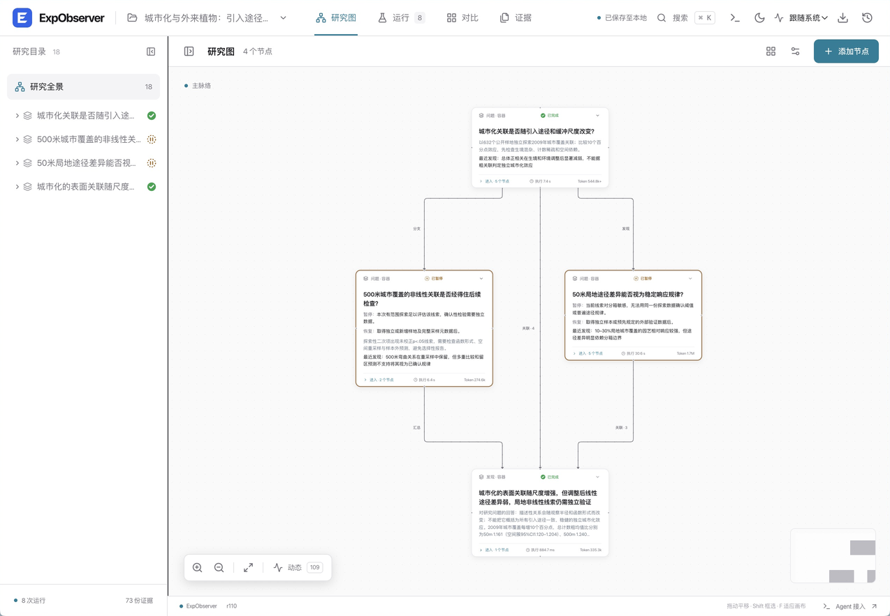
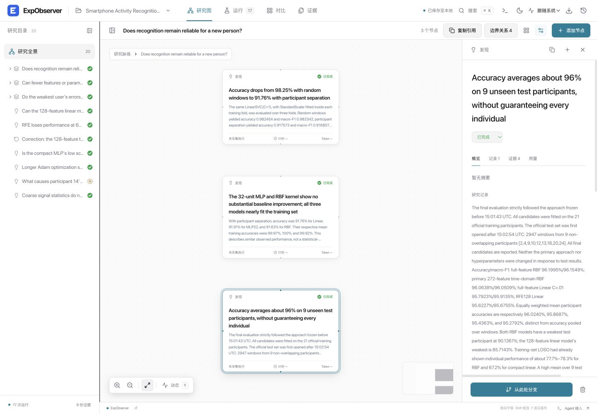

  

<h1 align="center">ExpObserver</h1>

<strong>See how your agent's research unfolds.</strong>

Questions, experiments, evidence, and findings — connected in one local workspace.

  
  
  

  <a href="#quick-start">Quick start</a> ·
  <a href="docs/usage.md">User guide</a> ·
  <a href="skills/exp-observer/SKILL.md">Agent Skill</a> ·
  <a href="README.zh-CN.md">简体中文</a>

A real exploratory study: follow the main story, then enter a container to inspect the work behind it.

## Research you can follow

| Follow the reasoning | Inspect the evidence |
| :--- | :--- |
| **Nested research spaces.** Keep the main story readable; open containers for subquestions, alternatives, and deeper experiments. | **Original results.** Inspect retained files, command output, configuration, and comparisons beside the graph. |
| **Work across conversations.** A portable Skill lets multiple agent chats contribute to the same experiment. Copy a node reference to discuss a specific step. | **Visible progress and cost.** See completed, paused, excluded, and failed work, with captured timing and available Token usage. |

Your agent chooses the research approach. ExpObserver preserves how it develops, including negative results and unfinished questions. Records, revision history, and evidence stay on your computer.

## A real study, in 28 minutes

**Can a smartphone activity classifier stay reliable for a new person — with a smaller model?** An independent agent explored UCI HAR, trained small models locally, investigated a persistent failure, and left one causal question paused with a clear next step.

The English case includes the research graph, measured usage, and six original evidence files. **272 inputs retained 96.06% test accuracy; a 128-input linear model reduced weights and biases to 3,096 bytes.**

[Explore the English case and load it into ExpObserver →](examples/har-study/README.md)

## Quick start

### Ask your agent

Send this instruction to your agent:

> Install and start ExpObserver and its Skill by following https://github.com/EuanTop/exp-observer/blob/main/INSTALL.md.

### Or start it yourself

1. [Download **exp-observer.zip**](https://github.com/EuanTop/exp-observer/releases/latest/download/exp-observer.zip) and extract it.
2. Launch **start.bat** on Windows or **start.command** on macOS. On Linux, run `python3 start.py`.
3. Open **Connect Agent**, connect your research directory, and copy the instruction into your agent chat.

Requires **Python 3.10+**. The ready-to-run package needs no Node.js, pip packages, account, or model API key. [Installation & upgrades →](INSTALL.md)

Then give your agent a research task:

> Use the ExpObserver Skill for experiment `my-study`. Investigate my question, retain the evidence, and keep the experiment up to date as you work.

The Skill can wake the installed platform when it is closed. Records queue locally if the service is unavailable.

<strong>A closer look: explore a research step and reference it in your next conversation</strong>

Select a node and choose **复制引用** (Copy reference). Paste it into any agent chat and add your question. The reference carries the experiment and node identity, so the agent can read the latest context.

## Explore further

[User guide](docs/usage.md) · [Skill](skills/exp-observer/SKILL.md) · [API & data contract](docs/contract.md) · [HAR case](examples/har-study/README.md) · [Exact-search case](examples/real-study/report.md) · [Contributing](CONTRIBUTING.md)

Built with React, TypeScript, Tailwind CSS, React Flow, ELK, and Python. [MIT licensed](LICENSE).
