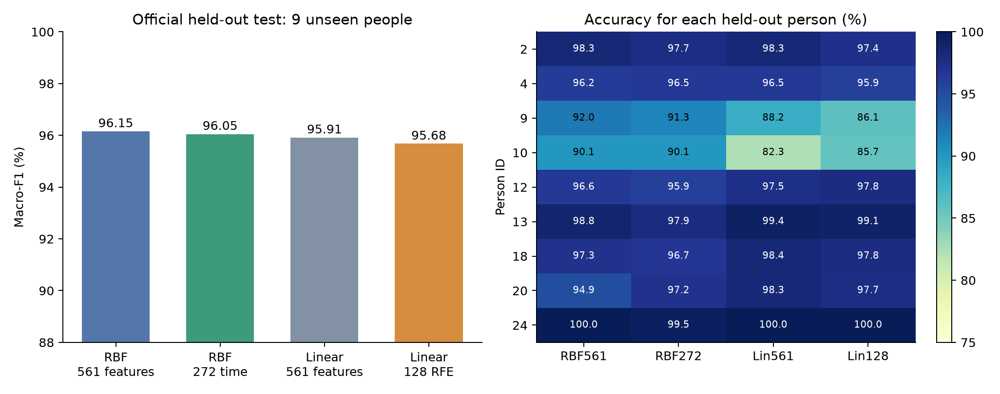

# Smartphone activity recognition: does it work for a new person?

A **real 28-minute agent investigation**, translated into English. The agent trained small models locally, followed unexpected results, corrected a transcription error, and retained an unanswered question. ExpObserver captured the work as it happened.



## The question and the exploration

Can a smartphone activity classifier remain reliable for an unseen person, while using fewer features or smaller model weights?

The study used [UCI Human Activity Recognition Using Smartphones](https://archive.ics.uci.edu/dataset/240/human+activity+recognition+using+smartphones): 30 participants, six activities, and 561 engineered features from a waist-mounted phone. The [dataset paper](https://www.esann.org/sites/default/files/proceedings/legacy/es2013-84.pdf) describes its collection and benchmark.

The agent compared random-window validation with participant-separated validation, then explored feature groups, linear models, recursive feature elimination, and a compact neural network. A failed compact MLP led to a bounded optimization check rather than an immediate rejection of neural networks. A weak participant led to a separate signal-diagnosis branch. Neither branch was scripted in advance.

Model selection used training participants only, including grouped and leave-one-participant-out validation. Four candidates were frozen before evaluating the official 2,947-window test set from nine other participants.

| Frozen model | Inputs | Test accuracy | Macro-F1 |
| :--- | ---: | ---: | ---: |
| Full RBF SVM | 561 | 96.20% | 96.15% |
| **Time-domain RBF SVM** | **272** | **96.06%** | **96.05%** |
| Full linear model | 561 | 95.79% | 95.91% |
| RFE linear model | 128 | 95.62% | 95.68% |

The 272-input model retained similar average performance with **51.5% fewer engineered inputs**. The 128-input linear endpoint used 774 float32 weights and biases (3,096 bytes; 5,006-byte NPZ), with weaker individual performance. These are observed tradeoffs on this dataset; phone energy use and end-to-end feature-extraction cost were not measured.

## What remained unresolved

Participant 14's walking windows were consistently classified as walking upstairs, even when training on the other 20 training participants. Coarse signal statistics did not identify a cause. The agent **paused the causal question**, recording what was missing and when to resume: collection metadata, original video, or independently labeled comparable participant data.

The record contains 20 nodes, 36 relations, 23 run records (17 captured command executions), and 52 measured usage records. Nineteen nodes are completed and one is paused. The English snapshot preserves those states, containment, connections, numerical results, and the earlier error followed by its explicit correction.

## Open the English case

From the repository or extracted release folder, with ExpObserver running:

```bash
python3 examples/har-study/load_example.py
```

On Windows, use `python` instead of `python3`. Select **Smartphone Activity Recognition: Cross-User Reliability and Compact Models** in the project menu. The loader checks evidence hashes, resolves paths for this computer, imports a separate English project, and registers retained evidence copies. Running it again keeps the existing copy and completes any interrupted evidence import. Use the loader rather than importing `project.en.json` alone: that file contains portable evidence references.

## Inspect the retained evidence

- [Final metrics and frozen candidates](evidence/final-metrics.json)
- [Every official test prediction](evidence/test-predictions.csv)
- [Validation comparison](evidence/validation-comparison.csv), [inference cost](evidence/inference-cost.csv), and [confusion matrices](evidence/confusion-matrices.png)
- [Provenance, checksums, and translation notes](provenance.json)

Verify all four test accuracies, macro-F1 scores, and confusion matrices without training or installing ML packages:

```bash
python3 examples/har-study/verify_predictions.py
```

This portable case includes six original evidence files. Raw dataset files, trained model binaries, and the complete local training workspace are not bundled. Machine paths and host session identifiers were removed. Token counters remain measured values; input includes cached tokens, and early shell-wrapped calls have coarse node attribution.
